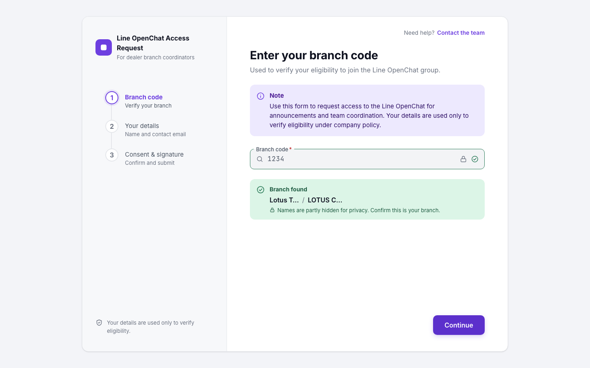
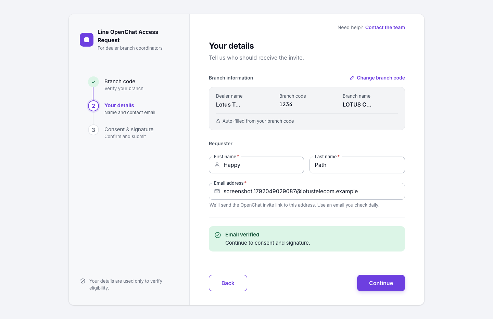
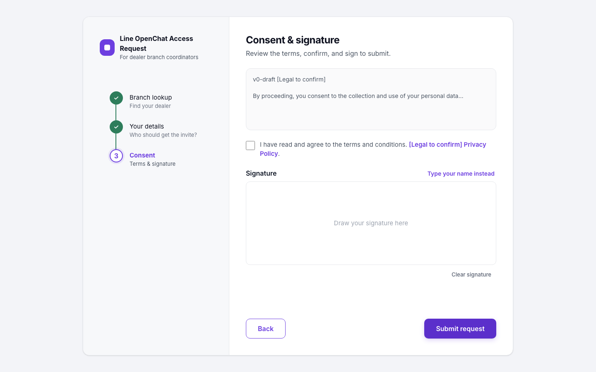
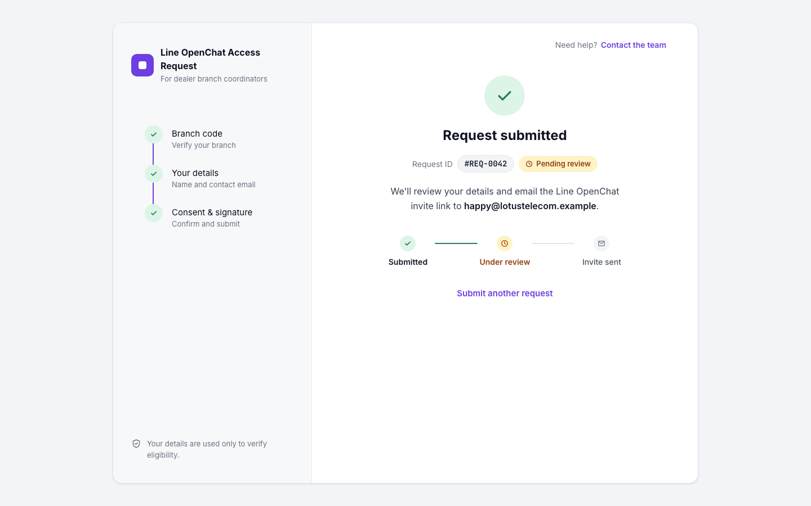

# Dealer Access Portal

A portfolio demo of a **Line OpenChat access request** flow for dealer branch staff:
branch lookup → email OTP → consent + signature → admin approval → invite by email.
Built with Next.js, TypeScript and a violet Soft-UI design system.

> **Status: work in progress.** The public request form (Phase 2) is complete.
> The database foundation (Phase 3A: schema, migrations, seed, and db tests) is implemented.
> Server-side API integration, admin back-office, and real email delivery are planned (see Roadmap).
> **All data is fictional.** Companies, people, branch codes and emails are invented (`*.example` domains).
> The OpenChat room URL is a placeholder and is never sent to the browser.

## Screenshots

| Branch lookup | Your details | Consent & signature | Request submitted |
|---|---|---|---|
|  |  |  |  |

Edge-case scenario states live in `screenshots/phase2c/`. Target viewport is 1440px desktop (ADR 15).

## What works today

- 4-step public form: branch lookup with masked dealer/branch names, requester details, email OTP, consent and drawn/typed signature
- OTP rules as pure, tested functions: 6 digits, 10-minute expiry, 60-second resend cooldown, max 3 attempts
- Email-domain mismatch is a warning only (never blocks)
- Honeypot field for bots
- Database foundation (Phase 3A): PostgreSQL 16 + Drizzle ORM schema (12 tables), migrations, idempotent seed, and integration tests
- `/dev/components` (component playground) and `/dev/scenarios?s=<id>` (10 deterministic UI states); both return 404 in production
- Bundle-leak check (`pnpm check:bundle`) that fails if the room URL or sample emails reach the client bundle
- Accessibility: axe checks on every step and scenario, WCAG AA contrast, keyboard focus handling

## Try it locally

Requires Node 22, pnpm, and Docker (for PostgreSQL & Mailpit).

```bash
# 1. Install dependencies
pnpm install

# 2. Start local containers (Postgres 16 + Mailpit)
pnpm db:up

# 3. Run database migrations & seed fixtures
pnpm db:migrate
pnpm db:seed

# 4. (Optional) Run database integration tests
pnpm test:db

# 5. Start dev server
pnpm dev          # http://localhost:3000
```

Demo inputs:

| Input | Value |
|---|---|
| Branch code (found) | `1234` |
| Branch code (inactive / not found) | `9999`, `0000` |
| OTP code (mock) | `123456` |

## Scripts

| Command | Purpose |
|---|---|
| `pnpm lint` / `pnpm typecheck` | ESLint / TypeScript |
| `pnpm test` | Vitest unit tests (runs without Docker) |
| `pnpm test:db` | Vitest database integration tests against `openchat_test` |
| `pnpm e2e` | Playwright end-to-end + axe accessibility tests |
| `pnpm build` then `pnpm check:bundle` | Production build and client-bundle leak check |
| `pnpm db:up` / `pnpm db:down` | Start / stop local PostgreSQL 16 and Mailpit containers |
| `pnpm db:generate` | Generate Drizzle migrations (`drizzle/`) |
| `pnpm db:migrate` | Apply Drizzle migrations |
| `pnpm db:seed` | Idempotently seed dealers, branches, rooms, and consent text |

## Tech stack

Next.js (App Router), React, TypeScript (strict), Tailwind CSS v4, React Hook Form + Zod,
Vitest + Testing Library, Playwright + axe-core, PostgreSQL 16 + Drizzle ORM, Mailpit.

## Design and decisions

- Design source of truth: [`design/`](design/) (exported from Claude Design), summarised in [`docs/DESIGN_SPEC.md`](docs/DESIGN_SPEC.md)
- Architecture decisions (ADR 1–14): [`docs/DECISIONS.md`](docs/DECISIONS.md)
- Plan and phases: [`docs/PLAN.md`](docs/PLAN.md)
- Interfaces keep infrastructure swappable: `EmailSender`, `InviteLinkBuilder`, `StorageProvider`, `AuthProvider`

## Roadmap

| Phase | Scope | Status |
|---|---|---|
| 1 | Scaffold, design tokens, base components | Done |
| 2 | Public request form, mock logic, scenarios, tests | Done |
| 3A | Database foundation (schema, migrations, seed, tests) | Done |
| 3B | Server-side branch lookup, checks, rate limiting & zero PII | Done |
| 4 | Admin back-office (approve / reject) | Planned |
| 5 | Email delivery via Mailpit (OTP and invite) | Planned |
| 6 | Local runbook and polish | Planned |

## Notes

- Consent text is a draft placeholder (`v0-draft [Legal to confirm]`) and not legal advice.
- Built with AI-assisted tooling; see `CLAUDE.md` and `AGENTS.md` for the working rules used.
- License: not yet specified (all rights reserved). Add a `LICENSE` file if you want others to reuse the code.